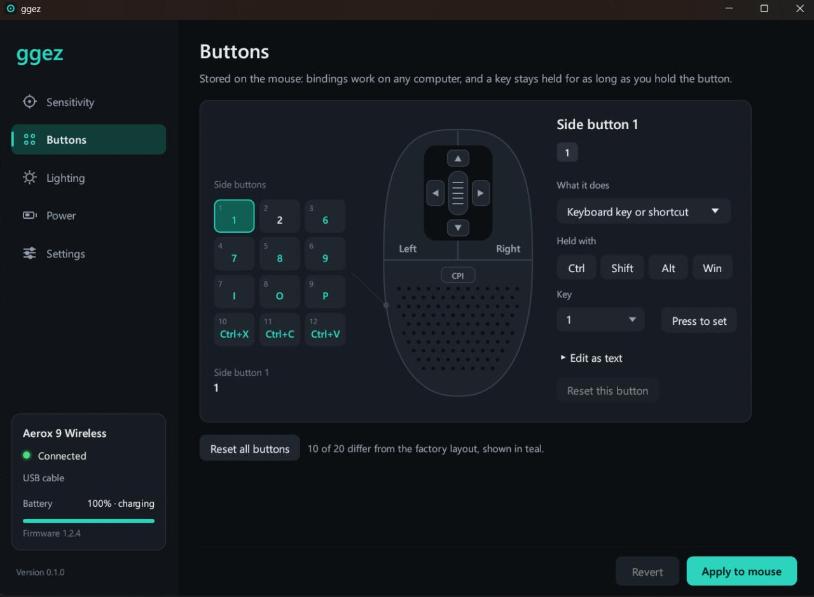
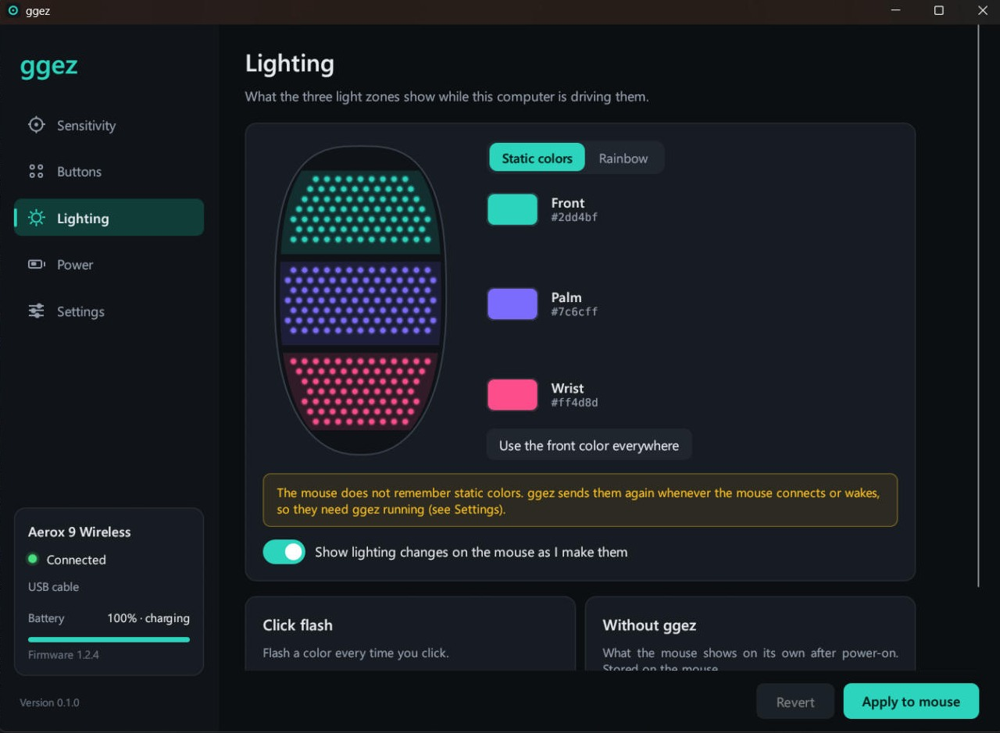
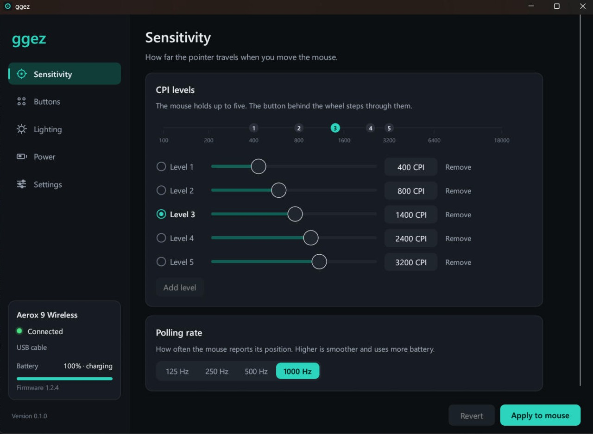

# ggez

An open-source replacement for SteelSeries GG for the **Aerox 9 Wireless**
mouse, for Windows, macOS and Linux.

ggez sets the mouse up and gets out of the way. Settings are written to the
mouse itself wherever the mouse can hold them, so they keep working with
ggez closed, or on a computer that has never heard of it.

> **Status: early, and tested on one mouse.** Developed against an Aerox 9
> Wireless with firmware 1.2.4 on Windows 11. The macOS and Linux builds
> compile and pass their tests in CI but have not yet been run against a
> mouse. Not made by or affiliated with SteelSeries.



| | |
| --- | --- |
|  |  |

## What it does

| | |
| --- | --- |
| **Buttons** | Rebind all 18 buttons and both scroll directions: keys, shortcuts of up to four keys (Ctrl+Shift+K), mouse buttons, media keys, CPI cycle, or nothing. Bindings live on the mouse, and a key stays held for as long as you hold the button. |
| **Sensitivity** | Up to five CPI levels, 100-18000. |
| **Polling rate** | 125, 250, 500 or 1000 Hz. |
| **Lighting** | A color per zone, the built-in rainbow, brightness, a flash on click, lights off while the mouse moves, and what the mouse shows when no software is driving it. |
| **Power** | Sleep and dim timers, and a battery saver (lights off, 125 Hz, the mouse's own power-saving mode). Battery level and charging state. |
| **Profiles** | Your whole setup is one small text file you can copy between computers. Keep several and switch between them in a click. |

It works through the USB cable and the 2.4 GHz dongle. Bluetooth is not
supported yet.

**Quit SteelSeries GG first.** GG keeps sending its own settings to the
mouse, which overrides yours and makes commands fail.

## The app

`ggez-gui` opens a window with everything above. Click a button on the
drawing of the mouse to rebind it, pick colors and watch the preview (and the
mouse itself) follow, then press **Apply to mouse**.

One thing the mouse cannot remember is static zone colors: after it powers
on it shows its built-in lighting until a computer sends colors again. ggez
has a small helper for that. It re-sends your colors whenever the mouse
connects or wakes, and does nothing else; it is never involved in movement
or clicks. Turn on **Settings → Start the helper when I log in**, or run it
yourself with `ggez daemon`.

On Windows the helper sits behind an icon in the notification area, by the
clock. Point at it for the battery level; click it to open the window;
right-click it to switch between your saved profiles or to quit. It tells
you when the battery is down to 15% and when a charge has finished. With
"start at login" on, closing the window leaves the icon running. macOS and
Linux do not have the icon yet; the helper runs there without one.

## The command line

```
ggez battery                          80%, charging
ggez firmware                         1.2.4
ggez dpi 800,1600,3200 --select 2
ggez polling 1000
ggez color --all "#ff8000" --bottom blue
ggez reactive red                     (or: ggez reactive off)
ggez rainbow
ggez default-lighting off             off, reactive, rainbow, reactive-rainbow
ggez sleep 5                          minutes, 0-20
ggez dim 30 --brightness 60 --smart   seconds 0-1200, percent, lights off while moving
ggez buttons g10=key:ctrl+x g11=key:ctrl+c g12=key:ctrl+v
ggez apply my-profile.toml            everything at once
ggez autostart enable                 start the helper at login
```

Each command saves to the mouse's memory unless you add `--no-save`.
`--dry-run wired` (or `wireless`) prints the bytes instead of sending them.
`ggez --help` lists everything.

`ggez buttons` sets **all** bindings at once, because the mouse cannot
report its current ones: any button you do not list goes back to its factory
binding.

Buttons are `left`, `right`, `middle`, `tilt-left`, `tilt-right`, `dpi`,
`g1`-`g12` (the side grid, numbered as printed) and `scroll-up`,
`scroll-down`. Actions are `disabled`, `left`, `right`, `middle`, `back`,
`forward`, `dpi`, `scroll-up`, `scroll-down`, `key:<key>[+<key>…]` and
`media:<name>`.

## Profiles

```toml
dpi = [400, 800, 1400, 2400, 3200]
dpi_select = 3
polling = 1000
effect = "static"

[colors]
top = "#ff0000"
middle = "#00ff00"
bottom = "#0000ff"

[buttons]
g12 = "key:ctrl+v"
```

Every key is optional. [profile.example.toml](profile.example.toml) shows
them all. The app and the helper use the profile at the path printed by
`ggez profile-path`.

### Several profiles

Keep one setup for work and another for games, and switch with one click
in the app's sidebar or one command:

```
ggez profile save Work        save the settings in use under a name
ggez profile list             the one in use is marked with *
ggez profile use Games        send a saved profile to the mouse
ggez profile delete Games
```

Switching rewrites the mouse's settings, bindings included, which takes
about a tenth of a second.

## Install

Downloads are on the
[Releases page](https://github.com/Thrasherop/ggez/releases):

| System | Download | Then |
| --- | --- | --- |
| Windows 10 or 11 | `ggez-…-windows-x64-setup.exe` | Run it. It installs for you alone and does not ask for administrator rights. |
| macOS 11 or newer, Intel or Apple Silicon | `ggez-…-macos.dmg` | Open it and drag ggez to Applications. |
| Linux, x64 | `ggez-…-linux-x64.tar.gz` | Unpack it, and install the udev rule as shown below. |

The downloads are not signed yet, so the system asks before running them.
On Windows choose **More info → Run anyway**. On macOS open **System
Settings → Privacy & Security** after the first attempt and choose **Open
Anyway**.

If the Releases page is empty, no version has been published yet: each
[CI run](https://github.com/Thrasherop/ggez/actions) attaches the bare
programs. Or build it yourself:

```
cargo build --release
```

That needs Rust 1.88 or newer. On Linux also install
`libudev-dev libxkbcommon-dev libwayland-dev libxcb-render0-dev
libxcb-shape0-dev libxcb-xfixes0-dev`, and give yourself access to the
device with the udev rule in
[packaging/linux/70-ggez.rules](packaging/linux/70-ggez.rules):

```
sudo cp packaging/linux/70-ggez.rules /etc/udev/rules.d/
sudo udevadm control --reload && sudo udevadm trigger
```

## How it works, and how sure we are

[docs/PROTOCOL.md](docs/PROTOCOL.md) records everything known about the
mouse's protocol, and marks each fact as seen working, accepted by the
mouse, or still a guess. In short:

- Buttons, zone colors, power-on lighting and saving have been checked by a
  person pressing buttons and looking at the mouse.
- CPI, polling rate, the timers, brightness and the battery saver are
  acknowledged by the mouse and, where compared, match GG's bytes exactly;
  their effect has not been measured.
- ggez is not in the path your movement and clicks take. It writes settings
  and exits.

## Not done yet

See the [issues](https://github.com/Thrasherop/ggez/issues). The larger
gaps: macros, Bluetooth, and testing on macOS and Linux.

Three things GG offers are deliberately left out, because GG does them in
software on the computer and not on the mouse: angle snapping, acceleration,
and animated lighting effects other than the built-in rainbow. The mouse
has no setting for them.

## Layout

| | |
| --- | --- |
| `crates/ggez-core` | The protocol and the device. No user interface. |
| `crates/ggez-service` | Profiles, the background helper, start at login. |
| `crates/ggez-cli` | The `ggez` command. |
| `crates/ggez-gui` | The `ggez-gui` app. |
| `tools/` | Windows scripts for capturing and decoding USB traffic. |

## Credits and license

The starting point for the protocol was
[rivalcfg](https://github.com/flozz/rivalcfg) by Fabien Loison and
contributors. The button table and the rest were worked out from USB
captures.

MIT. See [LICENSE](LICENSE).
