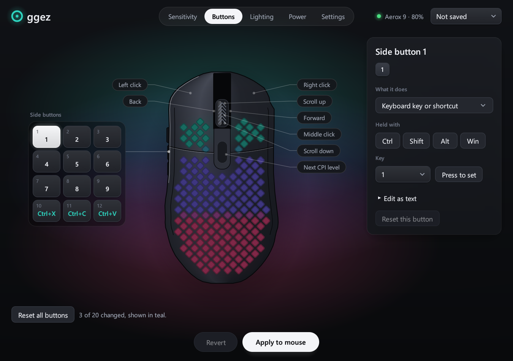
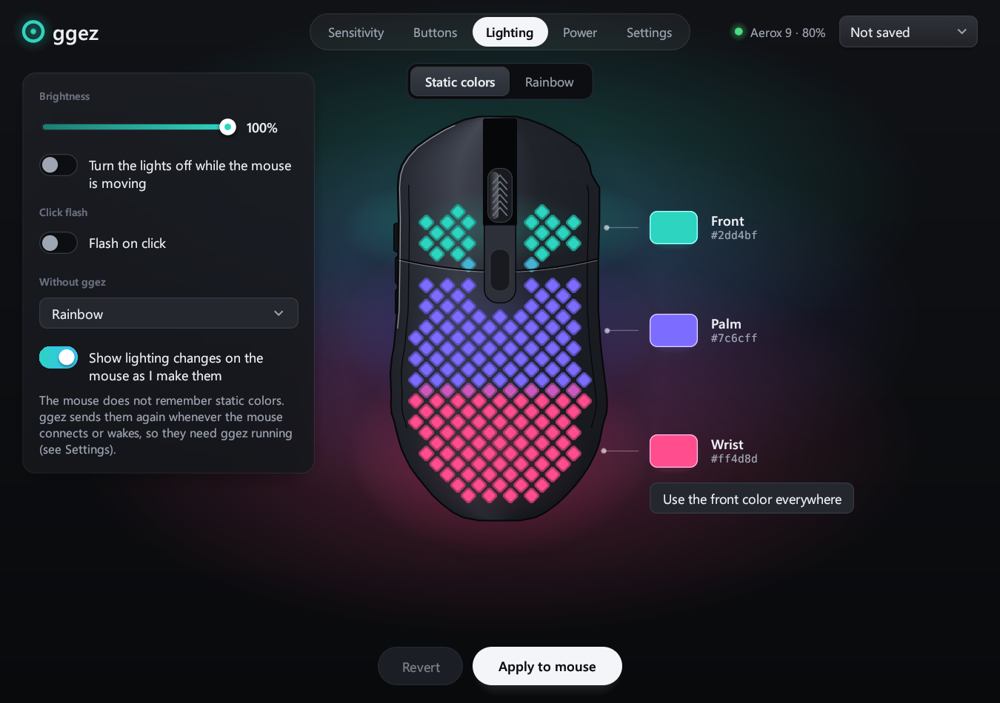
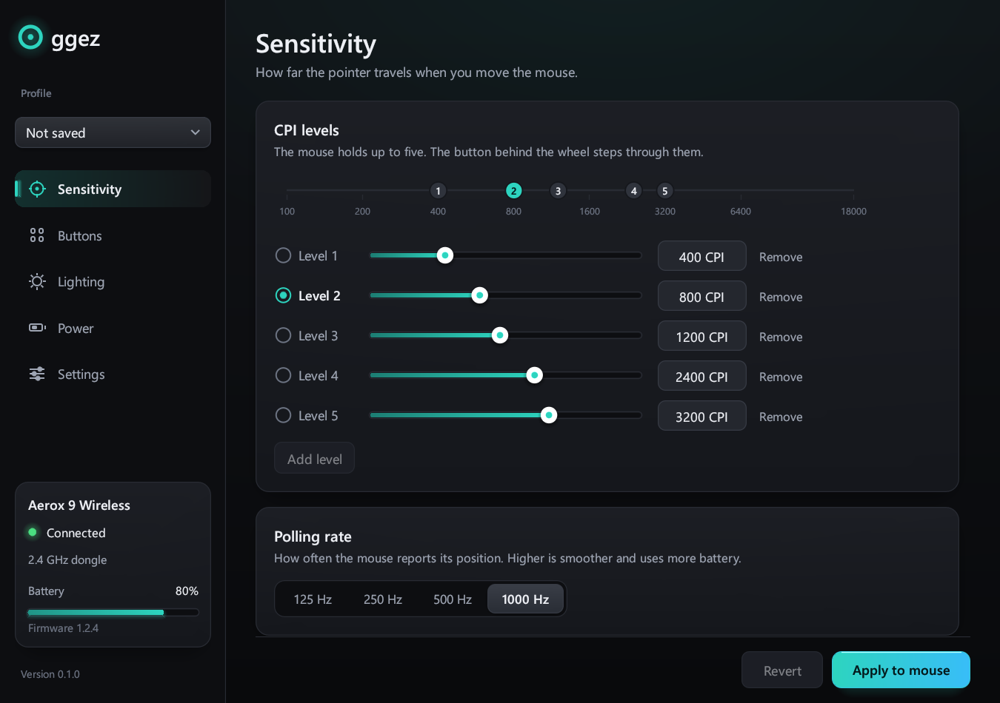

# ggez

An open-source replacement for SteelSeries GG for the **Aerox 9 Wireless**
mouse, for Windows, macOS and Linux.

ggez sets the mouse up and gets out of the way. Settings are written to the
mouse itself wherever the mouse can hold them, so they keep working with
ggez closed, or on a computer that has never heard of it.

> **Status: early, and tested on one mouse.** Developed against an Aerox 9
> Wireless with firmware 1.2.4 on Windows 11. On a Mac it finds the mouse;
> little else has been tried there yet. The Linux build passes its tests
> but has not been run against a mouse.
> [What has and has not been tried](#how-it-works-and-how-sure-we-are) is
> kept up to date below. Not made by or affiliated with SteelSeries.



| | |
| --- | --- |
|  |  |

## What it does

| | |
| --- | --- |
| **Buttons** | Rebind all 18 buttons and both scroll directions: keys, shortcuts of up to four keys (Ctrl+Shift+K), mouse buttons, media keys, CPI cycle, or nothing. Bindings live on the mouse, and a key stays held for as long as you hold the button. |
| **Macros** | A button can run a list of steps: shortcuts one after another, typed text, clicks, pauses. Once per press, again and again while held, or switched on and off. Windows and macOS, and only while ggez is running. |
| **Sensitivity** | Up to five CPI levels, 100-18000. |
| **Polling rate** | 125, 250, 500 or 1000 Hz. |
| **Lighting** | A color per zone, the built-in rainbow, brightness, a flash on click, lights off while the mouse moves, and what the mouse shows when no software is driving it. |
| **Power** | Sleep and dim timers, and a battery saver (lights off, 125 Hz, the mouse's own power-saving mode). Battery level and charging state. |
| **Profiles** | Your whole setup is one small text file you can copy between computers. Keep several and switch between them in a click. |

It works through the USB cable and the 2.4 GHz dongle. Bluetooth is not
supported yet.

**Quit SteelSeries GG first.** GG keeps sending its own settings to the
mouse, which overrides yours and makes commands fail.

## The app

`ggez-gui` opens a window with everything above. Click a button on the
drawing of the mouse to rebind it, pick colors and watch the preview (and the
mouse itself) follow, then press **Apply to mouse**.

One thing the mouse cannot remember is static zone colors: after it powers
on it shows its built-in lighting until a computer sends colors again. ggez
has a small helper for that. It re-sends your colors whenever the mouse
connects or wakes, and does nothing else; it is never involved in movement
or clicks. Turn on **Settings → Start the helper when I log in**, or run it
yourself with `ggez daemon`.

On Windows the helper sits behind an icon in the notification area, by the
clock. Point at it for the battery level; click it to open the window;
right-click it to switch between your saved profiles or to quit. It tells
you when the battery is down to 15% and when a charge has finished. With
"start at login" on, closing the window leaves the icon running. macOS and
Linux do not have the icon yet; the helper runs there without one.

## The command line

```
ggez battery                          80%, charging
ggez firmware                         1.2.4
ggez dpi 800,1600,3200 --select 2
ggez polling 1000
ggez color --all "#ff8000" --bottom blue
ggez reactive red                     (or: ggez reactive off)
ggez rainbow
ggez default-lighting off             off, reactive, rainbow, reactive-rainbow
ggez sleep 5                          minutes, 0-20
ggez dim 30 --brightness 60 --smart   seconds 0-1200, percent, lights off while moving
ggez buttons g10=key:ctrl+x g11=key:ctrl+c g12=key:ctrl+v
ggez apply my-profile.toml            everything at once
ggez autostart enable                 start the helper at login
ggez update                           is there a newer ggez? (--install to get it)
```

Each command saves to the mouse's memory unless you add `--no-save`.
`--dry-run wired` (or `wireless`) prints the bytes instead of sending them.
`ggez --help` lists everything.

`ggez buttons` sets **all** bindings at once, because the mouse cannot
report its current ones: any button you do not list goes back to its factory
binding.

Buttons are `left`, `right`, `middle`, `tilt-left`, `tilt-right`, `dpi`,
`g1`-`g12` (the side grid, numbered as printed) and `scroll-up`,
`scroll-down`. Actions are `disabled`, `left`, `right`, `middle`, `back`,
`forward`, `dpi`, `scroll-up`, `scroll-down`, `key:<key>[+<key>…]` and
`media:<name>`.

## Profiles

```toml
dpi = [400, 800, 1400, 2400, 3200]
dpi_select = 3
polling = 1000
effect = "static"

[colors]
top = "#ff0000"
middle = "#00ff00"
bottom = "#0000ff"

[buttons]
g12 = "key:ctrl+v"
```

Every key is optional. [profile.example.toml](profile.example.toml) shows
them all. The app and the helper use the profile at the path printed by
`ggez profile-path`.

### One mouse, a PC and a Mac

Copy is Ctrl+C on Windows and Linux and Cmd+C on a Mac, and the mouse cannot
tell which it is plugged into. Write the modifier as `primary` and ggez
settles it for you:

```toml
[buttons]
g11 = "key:primary+c"   # Ctrl+C on Windows and Linux, Cmd+C on a Mac
```

In the app it is the **Ctrl/Cmd** button under "Held with". Each time the
mouse arrives at a computer, the helper there sends it that computer's
version, without storing it. So this needs ggez running on every computer
you use the mouse with: turn on "Start the helper when I log in" on each, and
use the same profile on each. A computer without ggez gets whatever the last
one left on the mouse. Bindings without `primary` are not re-sent and work
with no software running, as before.

### Macros

A macro is a button that runs a list of steps on the computer:

```toml
[macros.g7]
steps = ["key:ctrl+c", "wait:80", "key:alt+tab", "wait:200", "key:ctrl+v"]

[macros.g8]
mode = "repeat"        # for as long as the button is held
steps = ["click:left", "wait:40"]
```

| Step | What it does |
| --- | --- |
| `key:ctrl+c` | Press a key or a shortcut and let go. |
| `down:shift`, `up:shift` | Hold a key down, and let it go later. |
| `text:hello` | Type text, whatever the keyboard layout. |
| `click:left` | Click a mouse button: left, right, middle, back or forward. |
| `wait:50` | Pause, in milliseconds. |

`mode` is `once` (once for each press, the default), `repeat` (again and
again while the button is held) or `toggle` (from one press until the
next). In the app, choose **Macro: several steps** for a button.

What to know:

- **Macros need ggez running**, unlike everything else. The mouse cannot
  run them itself, so the helper does. Turn on **Settings → Start the
  helper when I log in**.
- **Windows and macOS so far.** On Linux the helper says so and the
  button does nothing.
- **Up to twelve buttons** can have a macro; on a Mac, the first eight.
  On the mouse, each one is bound to one of the keys F13 to F24, which
  few keyboards have; ggez catches that key before any program sees it
  and runs the steps. While a macro uses one of those keys, a real press
  of that key does the same. A Mac knows F13 to F20 only, and the keys
  are handed out in the order the buttons sit on the mouse (left, right,
  middle, the two tilts, the CPI button, side buttons 1 to 12, then the
  scroll directions), so there it is the first eight macro buttons in
  that order that work.
- **A Mac asks you first.** macOS lets a program press keys only if you
  have switched it on under **System Settings → Privacy & Security →
  Accessibility**. The macro editor says when that is still needed and
  has a button that opens the list. Macros start by themselves once ggez
  is switched on there; nothing needs restarting. Because the downloads
  are not signed yet, macOS may forget this when you install a newer
  ggez: if macros stop after an update, remove ggez from that list with
  the minus button and add it again.
- **`primary` in a step** is this computer's key, as in a binding:
  `key:primary+c` copies on a PC and on a Mac.
- On Windows, a program running as administrator does not receive what a
  macro types unless ggez runs as administrator too. On either system a
  few games ignore keys that do not come from a real keyboard.
- On a Mac, clicks from a macro are single clicks: two in a row are not
  read as a double click.

### Several profiles

Keep one setup for work and another for games, and switch with one click
at the top of the app's window or one command:

```
ggez profile save Work        save the settings in use under a name
ggez profile list             the one in use is marked with *
ggez profile use Games        send a saved profile to the mouse
ggez profile delete Games
```

Switching rewrites the mouse's settings, bindings included, which takes
about a tenth of a second.

## Install

Downloads are on the
[Releases page](https://github.com/Thrasherop/ggez/releases):

| System | Download | Then |
| --- | --- | --- |
| Windows 10 or 11 | `ggez-…-windows-x64-setup.exe` | Run it. It installs for you alone and does not ask for administrator rights. |
| macOS 11 or newer, Intel or Apple Silicon | `ggez-…-macos.dmg` | Open it and drag ggez to Applications. |
| Linux, x64 | `ggez-…-linux-x64.tar.gz` | Unpack it, and install the udev rule as shown below. |

The downloads are not signed yet, so the system asks before running them.
On Windows choose **More info → Run anyway**. On macOS, drag ggez to
Applications and then either run this in Terminal:

```
xattr -dr com.apple.quarantine /Applications/ggez.app
```

or try to open it once, go to **System Settings → Privacy & Security**,
and choose **Open Anyway**. Each release has a `SHA256SUMS.txt` to check a
download against. [CHANGELOG.md](CHANGELOG.md) says what changed in each
version.

### Updates

After that, ggez keeps itself up to date with one click. When a newer
version is out, a line at the top of the window says so; **Update now**
downloads it, checks it, and restarts ggez with it. On Windows the icon by
the clock tells you too. From a terminal, `ggez update --install` does the
same.

- **What it asks the internet.** Once a day, while the window is open or
  the Windows icon is running, ggez asks github.com for one small file:
  the list of downloads in the latest release. It sends nothing about you
  or your mouse. Turn it off with **Settings → Look for a new version once
  a day**; **Look now** still works when you ask.
- **Your settings stay.** An update replaces the programs and nothing
  else. Your profile, your saved profiles and "start at login" are kept
  where they were, apart from the programs, and the mouse keeps what is
  stored on it.
- **Nothing installs by itself.** Finding a newer version only shows the
  line. If you have changes that are not on the mouse yet, the update
  waits for you to apply or revert them.
- **What is checked.** The download has to match the checksum published
  with the release, so a file cut short or damaged on the way is thrown
  away. That is not proof of who made it: until the downloads are signed,
  an update is as trustworthy as github.com and this repository.
- **Where it cannot.** A copy that was not installed (unpacked from a CI
  run, or built from source), a Mac app that has not been moved to
  Applications, or Linux programs in a folder you cannot write to: the
  line then leads to the download page.
- **On a Mac**, macOS may ask again for the permissions you gave the old
  version (Input Monitoring, and Accessibility for macros), because the
  downloads are not signed.

### Building it yourself

If the Releases page is empty, no version has been published yet: each
[CI run](https://github.com/Thrasherop/ggez/actions) attaches the bare
programs. Or build it yourself:

```
cargo build --release
```

That needs Rust 1.88 or newer. On Linux also install
`libudev-dev libxkbcommon-dev libwayland-dev libxcb-render0-dev
libxcb-shape0-dev libxcb-xfixes0-dev`, and give yourself access to the
device with the udev rule in
[packaging/linux/70-ggez.rules](packaging/linux/70-ggez.rules):

```
sudo cp packaging/linux/70-ggez.rules /etc/udev/rules.d/
sudo udevadm control --reload && sudo udevadm trigger
```

## How it works, and how sure we are

[docs/PROTOCOL.md](docs/PROTOCOL.md) records everything known about the
mouse's protocol, and marks each fact as seen working, accepted by the
mouse, or still a guess. In short:

- Buttons, zone colors, power-on lighting and saving have been checked by a
  person pressing buttons and looking at the mouse.
- CPI, polling rate, the timers, brightness and the battery saver are
  acknowledged by the mouse and, where compared, match GG's bytes exactly;
  their effect has not been measured.
- ggez is not in the path your movement and clicks take. It writes settings
  and exits. The one exception is a button you give a macro: the helper
  catches that button's key and presses the macro's keys for it.

What has been tried where:

| | Windows | macOS | Linux |
| --- | --- | --- | --- |
| Finding and opening the mouse | Yes | Yes | No |
| Bindings, zone colors and saving to the mouse | Yes | No | No |
| Ctrl/Cmd bindings following the computer | No | No | No |
| Macros from a real button press | No | No | Not built |
| Updating itself with one click | Yes | No | No |

"No" means the code is written and its tests pass on that system in CI,
but nobody has yet watched it work with a mouse in hand. If you try one of
these, an [issue](https://github.com/Thrasherop/ggez/issues) saying what
happened is worth a great deal, whichever way it went.

## If something is wrong

**The app says "Not connected".** Wake the mouse with a click, check its
switch is on 2.4 GHz and not Bluetooth, and check the dongle or cable.
`ggez list` prints every interface of the mouse the system offers and
whether the settings one opens.

**The app says "Cannot open the mouse".** The mouse is there but the
system refused. The app shows the system's reason. On Linux it is nearly
always the udev rule under [Install](#install); on macOS, allow ggez under **Privacy &
Security → Input Monitoring**; on Windows, close SteelSeries GG.

**Settings change back by themselves.** SteelSeries GG is running and
re-sending its own. Quit it, including its icon by the clock. The app
warns when it sees GG.

**Colors are gone after the mouse wakes.** Zone colors are the one thing
the mouse does not keep. Turn on **Settings → Start the helper when I log
in**; the helper sends them again each time the mouse comes back.

**A macro does nothing.** Macros run in the helper, so it has to be
running: turn on start at login. On a Mac, ggez also has to be switched on
under **Accessibility**, and only the first eight macro buttons work; the
macro editor says which applies.

**Copy pastes, or Ctrl does what Cmd should.** The mouse came from the
other kind of computer and ggez is not running on this one to switch the
binding over. See [One mouse, a PC and a Mac](#one-mouse-a-pc-and-a-mac).

**ggez says nothing about a newer version.** It looks once a day, and
only if **Settings → Look for a new version once a day** is on; **Look
now** on the same page asks at once and says what it found, or why it
could not look.

**A button I did not list went back to factory.** `ggez buttons` sets all
bindings at once, because the mouse cannot report its current ones. Use a
profile, or the app, which always sends the whole set.

## Not done yet

See the [issues](https://github.com/Thrasherop/ggez/issues). The larger
gaps: macros on Linux, a shift layer, Bluetooth, signed downloads, and
testing on macOS and Linux.

Three things GG offers are deliberately left out, because GG does them in
software on the computer and not on the mouse: angle snapping, acceleration,
and animated lighting effects other than the built-in rainbow. The mouse
has no setting for them.

## Layout

| | |
| --- | --- |
| `crates/ggez-core` | The protocol and the device. No user interface. |
| `crates/ggez-service` | Profiles, the background helper, start at login. |
| `crates/ggez-cli` | The `ggez` command. |
| `crates/ggez-gui` | The `ggez-gui` app. |
| `tools/` | Windows scripts for capturing and decoding USB traffic. |

## Credits and license

The starting point for the protocol was
[rivalcfg](https://github.com/flozz/rivalcfg) by Fabien Loison and
contributors. The button table and the rest were worked out from USB
captures.

MIT. See [LICENSE](LICENSE).
